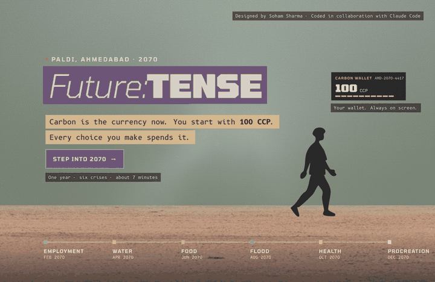

# Future: Tense

### What would you trade to get through one year in 2070?

**[▶ Play it in your browser](https://sooooham.github.io/future-tense/)** · about 7 minutes · best with sound · works on phones



It's 2070 in Paldi, Ahmedabad. Money has been replaced by **Carbon Credit Points**, and you start with 100. Over one year, six crises arrive two months apart: **employment, water, food, flood, health, and a state repopulation programme**. At each one you decide how to survive. Every choice costs carbon and moves four meters: **Privilege, Ethics, Personal Welfare and Community Welfare**. Some choices come back to you months later, mostly through your neighbour, Mrs. Patel in flat 3B.

At the end, the city prints your year as a receipt, and shows you who paid for it.

There is no right answer. That's the point.

---

## Why I made this

Most of us already know the climate facts. Knowing them hasn't changed much. I wanted to make something you *live through* instead of read: a place you recognise, choices you can't avoid, and a bill at the end. Every crisis in the game is stretched from something that is already happening in Indian cities today.

It started as my Semester 5 design project at NID, Ahmedabad, and grew into this website.

## I'd really like to hear from you

Play it once, honestly, and then tell me:

- **What did your receipt say?** Did it feel fair?
- **Which crisis felt closest to where you live?**
- **Where did it feel false, preachy or confusing?**

Post in **[Discussions](https://github.com/sooooham/future-tense/discussions)**. Criticism is more useful to me than praise. If it made you think, sharing it with one person is the biggest help.

## Run it locally

Plain HTML, CSS and JavaScript. No build step.

```
npx serve .
```

Or open the folder in VS Code and use the Live Server extension.

| File | What it does |
|---|---|
| `js/story.js` | All the writing: captions, choices, prices, meter effects, callbacks, verdicts |
| `js/engine.js` | Scroll camera, worlds and transitions, checkpoints, wallet and meters |
| `js/ending.js` | The receipt and the verdict |
| `js/audio.js` | Sound, generated live with Web Audio |
| `css/style.css` | The visual system |
| `assets/` | Skies and grounds (images), buildings and people (SVG) |

## Credits

Designed and written by **Soham Sharma** · Coded in collaboration with Claude Code

Sky images: made by the author. Ground textures: Adobe Stock (licensed) and generated in code. Fonts: Tomorrow, B612 Mono, Noto Sans Gujarati (SIL Open Font License, via Google Fonts).
